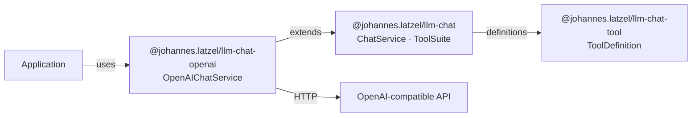

<a id="readme-top"></a>

<h1 align="center">@johannes.latzel/llm-chat-openai</h1>

[](https://opensource.org/licenses/MIT)
[](https://www.npmjs.com/package/@johannes.latzel/llm-chat-openai)
[](https://github.com/johanneslatzel/llm-chat-openai/releases)
[](https://www.typescriptlang.org/)
[](https://github.com/johanneslatzel/llm-chat-openai/pulls)
[](https://github.com/johanneslatzel/llm-chat-openai/discussions)
[](https://codecov.io/gh/johanneslatzel/llm-chat-openai)
[](https://github.com/johanneslatzel/llm-chat-openai/actions/workflows/ci.yml)
[](https://socket.dev/npm/package/@johannes.latzel/llm-chat-openai)
[](https://github.com/mefengl/made-by-ai)

<p align="center">
OpenAI and OpenAI-compatible provider for <code>@johannes.latzel/llm-chat</code>
</p>



<p align="center">
<a href="https://www.npmjs.com/package/@johannes.latzel/llm-chat-openai">npm</a>
&middot;
<a href="https://github.com/johanneslatzel/llm-chat-openai">GitHub</a>
&middot;
<a href="https://johanneslatzel.github.io/llm-chat-openai/">Docs</a>
&middot;
<a href="#quick-start">Quick start</a>
&middot;
<a href="https://johanneslatzel.github.io/llm-chat-openai/examples/">Examples</a>
&middot;
<a href="https://github.com/johanneslatzel/llm-chat-openai/issues">Issues</a>
&middot;
<a href="https://github.com/johanneslatzel/llm-chat-openai/releases">Releases</a>
</p>

<details>
<summary>Table of Contents</summary>

- [Why this package](#why-this-package)
- [Features](#features)
- [Prerequisites](#prerequisites)
- [Installation](#installation)
- [Quick start](#quick-start)
    - [Configure the client](#configure-the-client)
    - [Send a message](#send-a-message)
    - [Register tools](#register-tools)
- [Configuration](#configuration)
- [Structured output](#structured-output)
- [Usage and cost](#usage-and-cost)
- [Reasoning](#reasoning)
- [Local endpoints](#local-endpoints)
- [Troubleshooting](#troubleshooting)
- [Documentation](#documentation)
- [Related packages](#related-packages)
- [Development](#development)
- [Ecosystem](#ecosystem)
- [Contributing](#contributing)
- [License](#license)

</details>

## Why this package

The abstract engine in `@johannes.latzel/llm-chat` owns the tool-call loop,
streaming, hooks and session state. This package owns the OpenAI SDK
dependency, the OpenAI request and response mapping, and the provider
configuration.

`@johannes.latzel/llm-chat` does not re-export `OpenAIChatService` or
`OpenAIChatServiceConfiguration`. Import them from this package.

## Features

- `OpenAIChatService` and `OpenAIChatServiceBuilder`
- OpenAI Chat Completions streaming: content, reasoning, refusal, tool-call,
  usage and finish events
- temperature, token limits, stop, top-p, reasoning effort, tool choice,
  verbosity and streamed usage
- structured output through `response_format` (JSON object and JSON Schema)
- provider-neutral tool conversion with `toOpenAIFunctionTool()` and
  `toOpenAIFunctionTools()`
- environment-driven `OpenAIChatServiceConfiguration`
- works with OpenAI-compatible servers such as LM Studio, Ollama and vLLM

## Prerequisites

| Requirement | Value |
|---|---|
| Node.js | >= 22 |
| Module format | ESM-only (no CommonJS build) |
| API | OpenAI Chat Completions-compatible endpoint |
| TypeScript | Optional; `.d.ts` files included |

## Installation

```bash
npm install @johannes.latzel/llm-chat @johannes.latzel/llm-chat-openai
```

Install the tool primitives when defining custom tools:

```bash
npm install @johannes.latzel/llm-chat-tool
```

## Quick start

### Configure the client

The default client reads `OPENAI_API_KEY` and `OPENAI_BASE_URL` at
construction. Set a fallback model with `LLM_CHAT_OPENAI_DEFAULT_MODEL` or
pass `.model(...)`.

```bash
export OPENAI_API_KEY=sk-...
# Optional for an OpenAI-compatible server:
# export OPENAI_BASE_URL=http://localhost:1234/v1
```

### Send a message

```typescript
import { OpenAIChatService } from '@johannes.latzel/llm-chat-openai';

const service = OpenAIChatService.builder()
    .model('gpt-4.1')
    .systemPrompt('You are a helpful assistant.')
    .create();

await service.chat().user('Hello');
await service.send();

console.log(service.lastAssistantContent());
```

### Register tools

Tools come from `@johannes.latzel/llm-chat-tool`. The provider converts their
neutral definitions to OpenAI function tools automatically:

```typescript
import { Tool, ToolParameters, ResultStatus } from '@johannes.latzel/llm-chat-tool';
import { OpenAIChatService } from '@johannes.latzel/llm-chat-openai';

class TimeTool extends Tool {
    constructor() {
        super('time', 'Return the current time.', new ToolParameters({}, []));
    }

    protected async onExecute(): Promise<{ result: string; status: ResultStatus }> {
        return { result: new Date().toISOString(), status: ResultStatus.Success };
    }
}

const service = OpenAIChatService.builder().model('gpt-4.1').create();
service.tools().add(new TimeTool());

await service.chat().user('What time is it?');
await service.send();
```

The provider calls `ToolSuite.getDefinitions()` and
`toOpenAIFunctionTools()`. The converter can be reused for a custom
OpenAI-compatible provider:

```typescript
import { toOpenAIFunctionTools } from '@johannes.latzel/llm-chat-openai';

const tools = toOpenAIFunctionTools(service.tools().getDefinitions());
```

[Back to top](#readme-top)

## Configuration

Use the fluent builder for common options:

```typescript
const service = OpenAIChatService.builder()
    .model('gpt-4.1')
    .temperature(0.3)
    .maxTokens(2048)
    .systemPromptFile('AGENTS.md')
    .create();
```

For advanced options, construct `OpenAIChatServiceConfiguration` and pass it
with `.withOpenAIConfig(config)`. The base `ChatServiceConfiguration` is
passed with `.withServiceConfig(config)`. See
[Service and configuration](https://johanneslatzel.github.io/llm-chat-openai/service/)
for the provider properties and environment variables.

[Back to top](#readme-top)

## Structured output

```typescript
const service = OpenAIChatService.builder()
    .model('gpt-4.1')
    .jsonSchema({
        name: 'classification',
        strict: true,
        schema: {
            type: 'object',
            additionalProperties: false,
            required: ['label'],
            properties: { label: { type: 'string' } },
        },
    })
    .create();

await service.chat().user('Classify: my invoice is wrong.');
await service.send();

const result = service.lastAssistantJson<{ label: string }>();
```

`.jsonObject()` requests valid JSON without a schema. The schema is passed
through verbatim; this package does not rewrite or validate it. Parsing and
`StructuredOutputError` handling live in the engine. See
[Structured output](https://johanneslatzel.github.io/llm-chat-openai/examples/structured-output/).

[Back to top](#readme-top)

## Usage and cost

Streamed usage is opt-in because some compatible servers reject
`stream_options`:

```typescript
import {
    OpenAIChatService,
    OpenAIChatServiceConfiguration,
} from '@johannes.latzel/llm-chat-openai';

const config = new OpenAIChatServiceConfiguration();
config.includeUsage = true;

const service = OpenAIChatService.builder().withOpenAIConfig(config).model('gpt-4.1').create();
await service.chat().user('Hello');
await service.send();

const summaries = service.stream().summary();
const total = summaries.reduce((sum, s) => sum + (s.usage?.total_tokens ?? 0), 0);
```

See [Usage and cost](https://johanneslatzel.github.io/llm-chat-openai/examples/usage-and-cost/)
for a full cost calculation with cached input tokens.

[Back to top](#readme-top)

## Reasoning

The provider reads reasoning from `reasoning_details`, `reasoning` and
`reasoning_content` automatically. Inline reasoning markers can be enabled on
the base service configuration with `parseInlineReasoning`; parsed reasoning
arrives as `ChunkType.Reasoning`. See
[Reasoning streams](https://johanneslatzel.github.io/llm-chat-openai/examples/reasoning/).

Reasoning messages are stored in the chat and filtered from later requests by
default (`filterReasoning: true`).

[Back to top](#readme-top)

## Local endpoints

Point `OPENAI_BASE_URL` at any server implementing the OpenAI Chat Completions
API. The base URL normally ends in `/v1`.

| Server | `OPENAI_BASE_URL` |
|---|---|
| LM Studio | `http://localhost:1234/v1` |
| Ollama | `http://localhost:11434/v1` |
| vLLM | `http://localhost:8000/v1` |

Most local servers ignore the API key, but the client requires a non-empty
value. See [Local endpoints](https://johanneslatzel.github.io/llm-chat-openai/examples/local-endpoints/).

[Back to top](#readme-top)

## Troubleshooting

### Missing credentials

`OPENAI_API_KEY` must be a non-empty string. For servers without
authentication, use any placeholder.

### No model provided

Pass `.model("gpt-4.1")` or set `LLM_CHAT_OPENAI_DEFAULT_MODEL`. The
constructor throws when neither is present.

### The server rejects `stream_options`

Leave `includeUsage` at its default `false`.

### Wrong endpoint

`OPENAI_BASE_URL` is the full API prefix, ending in `/v1` for OpenAI.

[Back to top](#readme-top)

## Documentation

Full documentation at **[johanneslatzel.github.io/llm-chat-openai/](https://johanneslatzel.github.io/llm-chat-openai/)**.

- [Overview](https://johanneslatzel.github.io/llm-chat-openai/): package entry point
- [Quick start](https://johanneslatzel.github.io/llm-chat-openai/quickstart/): install and first request
- [Service and configuration](https://johanneslatzel.github.io/llm-chat-openai/service/): service options and builder
- [Environment variables](https://johanneslatzel.github.io/llm-chat-openai/env/): connection and provider settings
- [Architecture](https://johanneslatzel.github.io/llm-chat-openai/architecture/): provider boundary and request flow
- [API reference](https://johanneslatzel.github.io/llm-chat-openai/api-reference/): classes, builder and enums
- [Examples](https://johanneslatzel.github.io/llm-chat-openai/examples/): structured output, usage, reasoning and local endpoints
    - [Structured output](https://johanneslatzel.github.io/llm-chat-openai/examples/structured-output/): JSON mode and JSON Schema
    - [Usage and cost](https://johanneslatzel.github.io/llm-chat-openai/examples/usage-and-cost/): token usage and cost
    - [Reasoning](https://johanneslatzel.github.io/llm-chat-openai/examples/reasoning/): reasoning streams
    - [Local endpoints](https://johanneslatzel.github.io/llm-chat-openai/examples/local-endpoints/): LM Studio, Ollama and vLLM

[Back to top](#readme-top)

## Related packages

This package is the OpenAI / OpenAI-compatible provider implementing
`ChatService.createStream()`.

- [`@johannes.latzel/llm-chat`](https://johanneslatzel.github.io/llm-chat/): Provider-neutral chat engine: tool-call loop, streaming, hooks, prompt trees, serialization.
- [`@johannes.latzel/llm-chat-message`](https://johanneslatzel.github.io/llm-chat-message/): Provider-neutral message, role, finish-reason and writer primitives; zero runtime dependencies.
- [`@johannes.latzel/llm-chat-tool`](https://johanneslatzel.github.io/llm-chat-tool/): Provider-neutral tool, hook and result primitives; zero runtime dependencies.

[Back to top](#readme-top)

## Development

```bash
git clone https://github.com/johanneslatzel/llm-chat-openai.git
cd llm-chat-openai
npm install
npm run verify
```

`npm run verify` runs the type check, lint, file-size checks, documentation
checks, and the test suite with coverage.

[Back to top](#readme-top)

## Ecosystem

| Project | Docs | npm | Description |
|---------|------|-----|-------------|
| [llm-chat](https://github.com/johanneslatzel/llm-chat) | [docs](https://johanneslatzel.github.io/llm-chat/) | [npm](https://www.npmjs.com/package/@johannes.latzel/llm-chat) | abstract chat engine and tool loop |
| [llm-chat-message](https://github.com/johanneslatzel/llm-chat-message) | [docs](https://johanneslatzel.github.io/llm-chat-message/) | [npm](https://www.npmjs.com/package/@johannes.latzel/llm-chat-message) | message, role, finish-reason and writer primitives |
| [llm-chat-tool](https://github.com/johanneslatzel/llm-chat-tool) | [docs](https://johanneslatzel.github.io/llm-chat-tool/) | [npm](https://www.npmjs.com/package/@johannes.latzel/llm-chat-tool) | tool, result and hook primitives |
| [env](https://github.com/johanneslatzel/env) | [docs](https://johanneslatzel.github.io/env/) | [npm](https://www.npmjs.com/package/@johannes.latzel/env) | typed environment readers |
| [llm-chat-mcp](https://github.com/johanneslatzel/llm-chat-mcp) | [docs](https://johanneslatzel.github.io/llm-chat-mcp/) | [npm](https://www.npmjs.com/package/@johannes.latzel/llm-chat-mcp) | MCP server for the ecosystem |

[Back to top](#readme-top)

## Contributing

Issues and PRs are welcome at
[github.com/johanneslatzel/llm-chat-openai](https://github.com/johanneslatzel/llm-chat-openai).
Use conventional commit messages.

## License

MIT. See [`LICENSE`](LICENSE).
