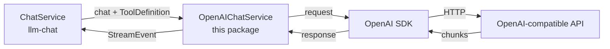

# Architecture

The provider maps the abstract engine onto the OpenAI Chat Completions API.

## Provider boundary

`OpenAIChatService` extends the abstract `ChatService` from
`@johannes.latzel/llm-chat`. The base class owns the chat history, message
queue, tool-call loop, hooks, stream aggregation and prompt loading.

The provider implements `createStream(signal)` and yields provider-neutral
`StreamEvent` values: content, reasoning, refusal, tool-call delta, usage and
finish.

## Request mapping

- `ChatMessage` roles map to OpenAI `system`, `developer`, `user`,
  `assistant` and `tool` roles.
- Reasoning messages are filtered from outgoing requests when
  `filterReasoning` is enabled (the default). An unfiltered
  `ChatRole.Reasoning` message is sent with the `assistant` role.
- The provider formats the timestamp prefix for conversation messages in
  its `toOutgoingContent` override; system prompts are never prefixed. The
  base class calls that hook for outgoing content and token estimates.
- Registered tools are read from `ToolSuite.getDefinitions()` as neutral
  `ToolDefinition` values and converted with `toOpenAIFunctionTools()` before
  the request.

## Response mapping

- `finish_reason` maps to `FinishReason`, including `content_filter`.
- `delta.content` becomes content events.
- `delta.refusal` becomes refusal events.
- Reasoning is read from `reasoning_details`, `reasoning` or
  `reasoning_content` in priority order.
- Tool-call deltas are forwarded without accumulation; the base service
  accumulates them.

## Structured output

The `responseFormat` option is passed through as `response_format`. The
provider does not rewrite or validate the schema. Parsing and validation of
assistant JSON happen in the base service.

## Configuration

`OpenAIChatServiceConfiguration` reads `LLM_CHAT_OPENAI_*` environment
variables in field initializers and accepts builder overrides or a configuration object passed to the service constructor.
The shared `@johannes.latzel/env` reader clamps the numeric token limits
(`maxTokens`, `maxCompletionTokens`) and trims optional strings; `temperature`
and `topP` are read as unbounded numbers. See [Environment variables](env.md).
