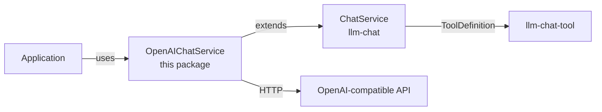

# Overview

`@johannes.latzel/llm-chat-openai` is the OpenAI and OpenAI-compatible
provider for `@johannes.latzel/llm-chat`. The abstract engine stays
provider-neutral; this package owns the OpenAI SDK dependency and the
provider-specific request and response handling.

## Navigation

- [Quick start](quickstart.md): install, configure and send a message
- [Service and configuration](service.md): `OpenAIChatService`, its builder and every option
- [Environment variables](env.md): `OPENAI_*` and `LLM_CHAT_OPENAI_*`
- [Examples](examples/index.md): structured output, usage, reasoning and local endpoints
- [Architecture](architecture.md): provider boundary and request flow
- [API reference](api-reference.md): classes, configuration and enums

## Related packages

This package is the OpenAI / OpenAI-compatible provider implementing
`ChatService.createStream()`.

- [`@johannes.latzel/llm-chat`](https://johanneslatzel.github.io/llm-chat/): Provider-neutral chat engine: tool-call loop, streaming, hooks, prompt trees, serialization.
- [`@johannes.latzel/llm-chat-message`](https://johanneslatzel.github.io/llm-chat-message/): Provider-neutral message, role, finish-reason and writer primitives; zero runtime dependencies.
- [`@johannes.latzel/llm-chat-tool`](https://johanneslatzel.github.io/llm-chat-tool/): Provider-neutral tool, hook and result primitives; zero runtime dependencies.

## License

MIT. See [`LICENSE`](https://github.com/johanneslatzel/llm-chat-openai/blob/main/LICENSE).
